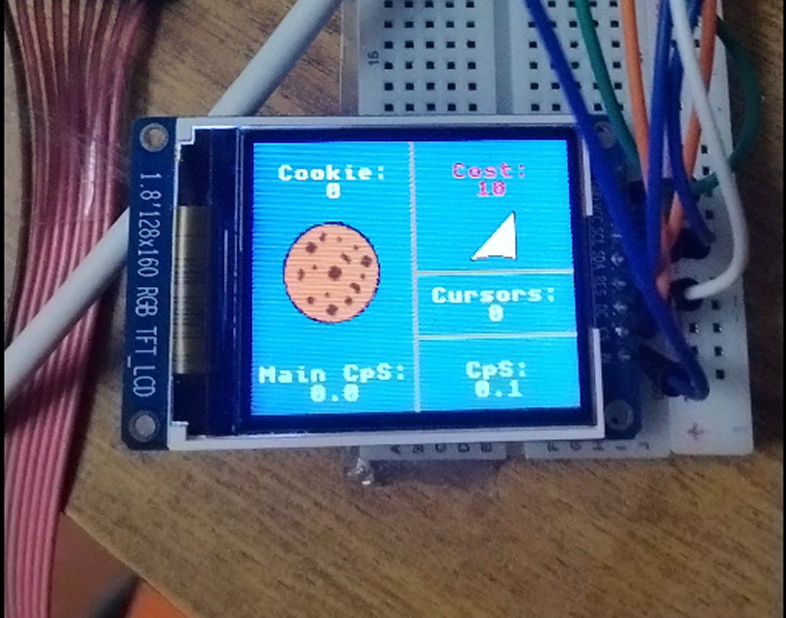
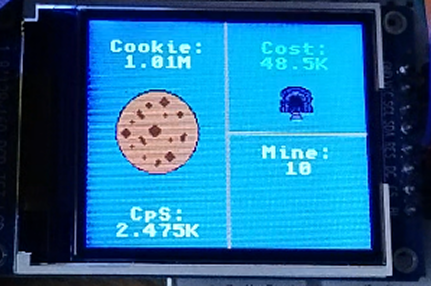
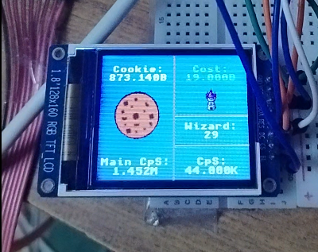

# ESP32-CookieClicker-MVP

MVP port of Cookie Clicker to ESP32-WROOM-32 with an ST7735 greentab2 screen and a 4x4 tactile matrix keypad

____
## Для запуска проекта нужны:

- ESP32 WROOM32 или ему подобные микроконтроллеры.
- ST7735 GREENTAB_2 RGB TFT LCD 160x128
- Матричная клавиатура 4*4
- Немного проводов

## Pinout:

### ST7735

|                | Pins         |
| ------------- |:-------------:|
| MOSI          | 23            |
| SCLK          | 18            |
| CS            | 5      |
| DS            | 2      |
| RES           | 4     |
| BL            | 21      |

### Keypad

|               | Pins         |
| ------------- |:-------------:|
| ROW 1          | 13            |
| ROW 2          | 19            |
| ROW 3            | 22      |
| ROW 4            | 17      |
| COL 1           | 27     |
| COL 2            | 26      |
| COL 3            | 25      |
| COL 4            | 14      |

## О проекте

Это мой первый публичный проект, собранный за пару дней. Изначально не было никакой цели, чистый энтузиазм и изучение нового.
____
### V0.1

- В самой первой версии мне только открывались основные механики кликеров. Переменные были сделаны через Unsigned long long и давали числа лишь до 19 квинтилионов. Для кликеров это ОЧЕНЬ МАЛО >:[
  
- Не было поддержки прозрачности картинок. Я подумывал о том что бы добавить ее но столкнулся с проблемой: ST7735 поддерживает только 16 бит, RGB565. Альфа канала, отвечающего за прозрачность не было, и узнал я это лишь тогда, когда залил 24-битный ARGB8888. Все поплыло, поломалось и замусорилось. Жаль что я тогда не сделал фотки(( Ну и я решил просто забить пока
  
- Было всего 3 типа автокликеров. Курсоры, бабушки и фермы. Сделать их было не трудно. Базовая математика и логика

- Форматирование чисел поддерживалось только до триллионов. Мне было лень разбираться и я успешно навайбкодил. Да да я лох :]

- Весь проект был в одном файле main.cpp но уже к концу v0.1 мне было тяжко ориентироваться в файле.

- Деньги начисляются раз в 10 секунд и это происходит резко, что в свою очередь отражается на дофамине в худшую сторону
  
#### В ОБЩЕМ:

Было просто, фaново, все такое новое и мне нравилось

____
### V0.2

- Появились новые автокликеры : шахта, фабрика, банк и храм

- Была добавлена большая, сочная и вкусная печенька!!!

- Прозрачность была реализована... но не так как вы думаете. Я просто покрасил прозрачные участки в цвет фона и все+++

- Добавлены спрайты для автокликеров в магазине. Их я тоже сгенерировал в ИИ, хотя изначально пытался нарисовать все руками((( Да да я лох >:]

- Появился счетчик кликов в секунду от автокликеров. Его проблема была в том, что нецелые числа счетчика округлялись и cps 0.1 от курсора просто не засчитывалось

- Форматирование теперь с ТоЧкОй еее. Но это не тип float или double. Это все еще unsigned long long. НО КАК!?!? Точка с целочисленным форматом? Кароче я точно не знаю ведь я навайбкодил и да да я лох >:] но вроде как там число делится на сколько-то, в зависимости от его разрядности и количества чисел. Для триллионов вроде как делим на 100к, Для миллиардов на 10к и вот так вот как то кароче ну я хз ващеее и между двумя целочисленными переменными (вторая это результат деления первой) стоит точка и определенный суффикс после числа.

- Теперь используется система "копеек", которая плавно и быстро начисляет цифры ВСЕГДА вместо разового платежа в 10 сек. Это очень сильно повышает дофамин и создает динамику. Еще теперь после точки не 1 знак а 3 а это значит что числа ЕЩЕ быстрее и ЕЩЕ динамичнее и ЕЩЕ БОЛЬШЕ дофамина

- Проект был разбит по разным cpp и h Файлам.

#### В ОБЩЕМ:

Проект расширялся, амбиции росли, планы увеличивались в экспоненте но вот мой сканерский мозг с этим не согласен... Он уже получил 90% дофамина с этого проекта и потихоньку перестает выделять энергию... Нейробиология сложная штука((
____
### V0.3 beta

И тут крах моих амбиций...

-Появился один автокликер: wizard tower

-Добавлены анимации! Печенька теперь постоянно крутится и при клике печенька пульсирует.

-Наконец-то перешел с unsigned long long на long double и double что расширило мои лимиты до 10^308!!! Этого для кликера обычного вполне хватит.

-Форматирование теперь с настоящей точкой и с настоящим нецелочисленным форматом. Еще после триллионов идет запись с мантисой и экспонентой. Че то типо: 10e15

-Прозрачность уже настоящая. Переход с rgb565 на rgb565a8 дало мне ровно то что надо- трушная прозрачность

-Реализован переход между экранами но он ломаный. Если у тебя есть автокликер и ты переходишь между экранами тебе резко начисляеются миллионы валюты при cps ~10

-Показатель cps одного здания в магазине

#### В ОБЩЕМ:

Переработана по большей части внутренняя структура, а не добавились новые функции.

По планам в версии 0.3 должны были появиться: экран с графическим отображением построек, апгрейды, новости, eще ~3 новых автокликеров, cистема молока и настройки. Но интерес пропал, мозг перестал выделять энергию на проект ну и че делать. Если такое происходит то я не могу продолжить проект поэтому я передаю его ВАМ! Доделывать я его уже точно не буду.
____

### Что можно добавить:
- Динамическая подгрузка спрайтов с SDcard модуля

- Новости, систему молока, добавить все кликеры до конца, сделать больше анимация что бы добавить сочности, сохранения, настройки, апгрейды и все что есть в куки кликере

- Что угодно вашего вы можете добавить.
____

### Баги:
-Когда cps = 0.2, ручные клики начисляются только за 2 нажатия.

-При переходе между экранами начисляются миллионы и трилионы и центилионы денег, в зависимости от твоего main cps

# ОТДАЮ ПРОЕКТ ВАМ

# ESP32-CookieClicker-MVP

MVP port of Cookie Clicker to ESP32-WROOM-32 with an ST7735 greentab2 screen and a 4x4 tactile matrix keypad

____
## Hardware Requirements:

- ESP32 WROOM32 or compatible microcontrollers.
- ST7735 GREENTAB_2 RGB TFT LCD 160x128
- 4*4 Matrix Keypad
- Some jumper wires

## Pinout:

### ST7735

|                | Pins         |
| ------------- |:-------------:|
| MOSI          | 23            |
| SCLK          | 18            |
| CS            | 5      |
| DS            | 2      |
| RES           | 4     |
| BL            | 21      |

### Keypad

|               | Pins         |
| ------------- |:-------------:|
| ROW 1          | 13            |
| ROW 2          | 19            |
| ROW 3            | 22      |
| ROW 4            | 17      |
| COL 1           | 27     |
| COL 2            | 26      |
| COL 3            | 25      |
| COL 4            | 14      |

## About the Project

This is my very first public project, whipped up in just a couple of days. Initially, there was no grand goal—just pure enthusiasm and a desire to learn something new.
____
### V0.1

- In the very first version, I was just scratching the surface of clicker mechanics. The variables used `unsigned long long`, limiting the cookie count to roughly 19 quintillion. For a proper clicker game, that is *WAY* too low >:[
  
- No alpha-channel transparency support. I thought about adding it but ran into a brick wall: ST7735 only supports 16-bit RGB565. There was no alpha channel for transparency, and I only found this out *after* uploading 24-bit ARGB8888 assets. Everything shifted, broke, and turned into visual garbage. Too bad I didn't take any photos back then (( Oh well, I just decided to ignore it for a while.
  
- Only 3 types of autoclickers: Cursors, Grandmas, and Farms. They weren't hard to build. Just basic math and logic.

- Number formatting was only supported up to trillions. I was too lazy to figure it out properly, so I just successfully vibecoded it. Yeah, yeah, I'm a loser :]

- The entire project was crammed into a single `main.cpp` file. By the end of v0.1, navigating through it was a massive pain.

- Income was credited once every 10 seconds in huge sudden chunks, which severely tanked the dopamine loop.
  
#### IN SHORT:

It was simple, fun, everything was brand new to me, and I loved it.

____
### V0.2

- New autoclickers unlocked: Mine, Factory, Bank, and Temple.

- A huge, juicy, and delicious main cookie was added!!!

- Transparency was finally implemented... but not the way you think. I literally just painted the transparent areas with the background color and called it a day +++

- Added sprites for the autoclickers in the shop. I generated them using AI, though initially, I tried drawing everything by hand ((( Yeah, yeah, I'm a loser >:]

- Added a Clicks-Per-Second (CPS) counter from autoclickers. The problem was that fractional numbers were rounded down, so the 0.1 CPS from a cursor just didn't register at all.

- Formatting now comes with a DeCiMaL pOiNt, let's gooo. But it's not a float or double type. It's still `unsigned long long`. BUT HOW!?!? A decimal point with an integer format? Honestly, I don't really know because I totally vibecoded it and yeah, yeah, I'm a loser >:] but basically, the number gets divided by a certain amount depending on its digit length and count. For trillions, we divide by 100k, for billions by 10k, or something like that, idk wtf is going on tbh. And there is a dot printed between two integer variables (the second one being the result of the division) followed by a specific suffix string.

- Switched to a "penny" system, which smoothly and rapidly increments the numbers ALL THE TIME instead of a single payout every 10 seconds. This massively spikes the dopamine levels and creates great dynamics. Also, now there are 3 digits after the decimal point instead of 1, which means the numbers tick up EVEN faster, EVEN more dynamically, and bring EVEN MORE dopamine.

- The project was refactored and split into separate .cpp and .h files.

#### IN SHORT:

The project expanded, ambitions skyrocketed, and plans multiplied exponentially... but my scanner brain completely disagreed with this. It had already collected 90% of the dopamine from this project and was slowly cutting off the energy supply... Neurobiology is a complicated thing ((
____
### V0.3 beta

And here comes the crash of my ambitions...

- Only one new autoclicker added: Wizard Tower.

- Animations are here! The cookie now constantly rotates, and when clicked, it pulses visually.

- Finally migrated from `unsigned long long` to `long double` and `double`, which expanded my limits up to 10^308!!! That's more than enough for a regular clicker game.

- Formatting now uses a real decimal point and actual floating-point math. Also, past trillions, it switches to scientific notation with mantissa and exponent. Something like: 10e15.

- Transparency is finally real. Switching from rgb565 to rgb565a8 gave me exactly what I needed—true transparency.

- Implemented screen transitions, but the system is glitchy. If you have active autoclickers and switch between screens, the game suddenly awards you millions of cookies out of nowhere at ~10 CPS.

- Displaying the CPS value for an individual building in the shop.

#### IN SHORT:

Most of the work went into refactoring the internal architecture rather than adding new features.

According to the original plans for v0.3, there should have been: a screen graphically displaying your buildings, upgrades, a news ticker, about 3 more new autoclickers, a milk system, and a settings menu. But the interest vanished, the brain stopped allocating energy to the project, and it is what it is. If this happens, I physically can't force myself to continue, so I am passing this project over to YOU! I am definitely not finishing it.
____

### What can be added:
- Dynamic asset loading for sprites using a MicroSD card module.

- A news ticker, milk system, the rest of the missing buildings, more juicy animations for extra juice, save slots, settings, upgrades, and basically everything else from the original Cookie Clicker.

- Literally whatever you want, you can add.
____

### Bugs:
- When CPS = 0.2, manual clicks only register every 2 presses.

- When switching between screens, the game awards millions, trillions, and centillions of cookies instantly, depending on your current main CPS.

# HANDING THE PROJECT OVER TO YOU

