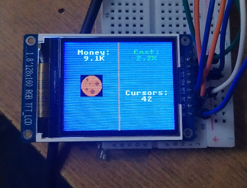

# ESP32-CookieClicker-MVP

MVP port of Cookie Clicker to ESP32-WROOM-32 with an ST7735 greentab2 screen and a 4x4 tactile matrix keypad

____
## Для запуска проекта нужны:

- ESP32 WROOM32 или ему подобные микроконтроллеры.
- ST7735 GREENTAB_2 RGB TFT LCD 160x128
- Матричная клавиатура 4*4
- Немного проводов

## Pinout:

### ST7735

|                | Pins         |
| ------------- |:-------------:|
| MOSI          | 23            |
| SCLK          | 18            |
| CS            | 5      |
| DS            | 2      |
| RES           | 4     |
| BL            | 21      |

### Keypad

|               | Pins         |
| ------------- |:-------------:|
| ROW 1          | 13            |
| ROW 2          | 19            |
| ROW 3            | 22      |
| ROW 4            | 17      |
| COL 1           | 27     |
| COL 2            | 26      |
| COL 3            | 25      |
| COL 4            | 14      |

## О проекте

Это мой первый публичный проект, собранный за пару дней. Изначально не было никакой цели, чистый энтузиазм и изучение нового.
____
### V0.1

- В самой первой версии мне только открывались основные механики кликеров. Переменные были сделаны через Unsigned long long и давали числа лишь до 19 квинтилионов. Для кликеров это ОЧЕНЬ МАЛО >:[
  
- Не было поддержки прозрачности картинок. Я подумывал о том что бы добавить ее но столкнулся с проблемой: ST7735 поддерживает только 16 бит, RGB565. Альфа канала, отвечающего за прозрачность не было, и узнал я это лишь тогда, когда залил 24-битный ARGB8888. Все поплыло, поломалось и замусорилось. Жаль что я тогда не сделал фотки(( Ну и я решил просто забить пока
  
- Было всего 3 типа автокликеров. Курсоры, бабушки и фермы. Сделать их было не трудно. Базовая математика и логика

- Форматирование чисел поддерживалось только до триллионов. Мне было лень разбираться и я успешно навайбкодил. Да да я лох :]

- Весь проект был в одном файле main.cpp но уже к концу v0.1 мне было тяжко ориентироваться в файле.

- Деньги начисляются раз в 10 секунд и это происходит резко, что в свою очередь отражается на дофамине в худшую сторону
  
#### В ОБЩЕМ:

Было просто, фaново, все такое новое и мне нравилось

____
### V0.2

- Появились новые автокликеры : шахта, фабрика, банк и храм

- Была добавлена большая, сочная и вкусная печенька!!!

- Прозрачность была реализована... но не так как вы думаете. Я просто покрасил прозрачные участки в цвет фона и все+++

- Добавлены спрайты для автокликеров в магазине. Их я тоже сгенерировал в ИИ, хотя изначально пытался нарисовать все руками((( Да да я лох >:]

- Появился счетчик кликов в секунду от автокликеров. Его проблема была в том, что нецелые числа счетчика округлялись и cps 0.1 от курсора просто не засчитывалось

- Форматирование теперь с ТоЧкОй еее. Но это не тип float или double. Это все еще unsigned long long. НО КАК!?!? Точка с целочисленным форматом? Кароче я точно не знаю ведь я навайбкодил и да да я лох >:] но вроде как там число делится на сколько-то, в зависимости от его разрядности и количества чисел. Для триллионов вроде как делим на 100к, Для миллиардов на 10к и вот так вот как то кароче ну я хз ващеее и между двумя целочисленными переменными (вторая это результат деления первой) стоит точка и определенный суффикс после числа.

- Теперь используется система "копеек", которая плавно и быстро начисляет цифры ВСЕГДА вместо разового платежа в 10 сек. Это очень сильно повышает дофамин и создает динамику. Еще теперь после точки не 1 знак а 3 а это значит что числа ЕЩЕ быстрее и ЕЩЕ динамичнее и ЕЩЕ БОЛЬШЕ дофамина

- Проект был разбит по разным cpp и h Файлам.

#### В ОБЩЕМ:

Проект расширялся, амбиции росли, планы увеличивались в экспоненте но вот мой сканерский мозг с этим не согласен... Он уже получил 90% дофамина с этого проекта и потихоньку перестает выделять энергию... Нейробиология сложная штука((
____
### V0.3 beta

И тут крах моих амбиций...

-Появился один автокликер: wizard tower

-Добавлены анимации! Печенька теперь постоянно крутится и при клике печенька пульсирует.

-Наконец-то перешел с unsigned long long на long double и double что расширило мои лимиты до 10^308!!! Этого для кликера обычного вполне хватит.

-Форматирование теперь с настоящей точкой и с настоящим нецелочисленным форматом. Еще после триллионов идет запись с мантисой и экспонентой. Че то типо: 10e15

-Прозрачность уже настоящая. Переход с rgb565 на rgb565a8 дало мне ровно то что надо- трушная прозрачность

-Реализован переход между экранами но он ломаный. Если у тебя есть автокликер и ты переходишь между экранами тебе резко начисляеются миллионы валюты при cps ~10

-Показатель cps одного здания в магазине

#### В ОБЩЕМ:

Переработана по большей части внутренняя структура, а не добавились новые функции.

По планам в версии 0.3 должны были появиться: экран с графическим отображением построек, апгрейды, новости, eще ~3 новых автокликеров, cистема молока и настройки. Но интерес пропал, мозг перестал выделять энергию на проект ну и че делать. Если такое происходит то я не могу продолжить проект поэтому я передаю его ВАМ! Доделывать я его уже точно не буду.
____

### Что можно добавить:
- Динамическая подгрузка спрайтов с SDcard модуля

- Новости, систему молока, добавить все кликеры до конца, сделать больше анимация что бы добавить сочности, сохранения, настройки, апгрейды и все что есть в куки кликере

- Что угодно вашего вы можете добавить.
____

### Баги:
-Когда cps = 0.2, ручные клики начисляются только за 2 нажатия.

-При переходе между экранами начисляются миллионы и трилионы и центилионы денег, в зависимости от твоего main cps

# ОТДАЮ ПРОЕКТ ВАМ

